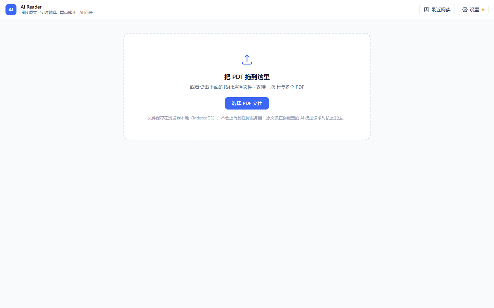

<div align="center">

# AI Read · AI Reader

**把「阅读原文 · 实时翻译 · 重点解读 · AI 问答」放进同一个界面的智能 PDF 阅读器**

左边读原文，右边看翻译；看到不懂的地方，直接问 AI。

[](https://vitejs.dev/)
[](https://react.dev/)
[](https://tailwindcss.com/)
[](https://mozilla.github.io/pdf.js/)
[](./LICENSE)

</div>



---

## 为什么做这个

读一份英文 PDF，通常要在四个工具之间来回切换：

| 工具 | 它解决的是 |
|------|-----------|
| 普通 PDF 阅读器 | 「让我看到这份 PDF」 |
| 翻译软件 | 「帮我把英文翻译成中文」 |
| AI 聊天软件 | 「回答我的问题」 |
| 词典 | 「这个词什么意思」 |

**AI Reader 要解决的是：帮我把一份 PDF 真正读懂。**

它介于「PDF 阅读器 + AI 翻译 + AI 教师 + AI 研究助手」之间，核心体验就是：左边读原文，右边看翻译，看到不懂的直接问。整个过程不需要 `复制 → 打开 ChatGPT → 粘贴 → 翻译 → 回来`。

> 最适合的用户：**能看懂一部分英文，但不愿意频繁查词、复制、切换软件的人。**

---

## 界面布局

```
┌─────────────────────────────────────────────────────────────┐
│ AI Reader            The Wealth of Nations.pdf           ⚙  │
├───────────────────────┬─────────────────────────────────────┤
│                       │  翻译   解读   问答   笔记           │
│                       │ ─────────────────────────────────── │
│                       │  原文 p1                            │
│   左侧 55%            │  The division of labor is limited   │
│                       │  by the extent of the market.       │
│   PDF 原文            │  ─────────────────────────────────  │
│   （可划词选中）      │  劳动分工受到市场规模的限制。        │
│                       │                                     │
│                       │  原文 p2 ...                        │
├───────────────────────┴─────────────────────────────────────┤
│                   第 32 / 428 页                             │
└─────────────────────────────────────────────────────────────┘
```

---

## 功能

| # | 功能 | 说明 |
|---|------|------|
| 1 | **PDF 上传** | 点击选择 / 拖拽上传 / 多文件管理 / 最近阅读 / 阅读进度自动保存 |
| 2 | **PDF 阅读** | pdf.js 渲染；上一页·下一页·输入页码·键盘方向键（←→ / PageUp / PageDown / 空格 / Home / End）；缩放 +/−/适应宽度 |
| 3 | **逐段对照翻译** | 按段落一一对应，**不是整页糊成一坨**；原文段 ↔ 译文段左右对照 |
| 4 | **重点解读** | 一句话总结 / 核心观点（含「为什么」）/ 具体举例 —— AI 不只是翻译机器，而是解释老师 |
| 5 | **划词解释** | 选中 PDF 文字即弹浮层：中文释义 + 简单理解 + 相关概念 + [详细解释] [加入生词本] |
| 6 | **AI 问答** | 三级上下文：① 选中文本（最高优先级）② 当前页 ③ 整本关键词检索；SSE 流式输出 |
| 7 | **扫描版识别** | 无文本层的扫描件 / 图片型 PDF，自动渲染成图片交给视觉模型，一次返回原文 + 译文 |
| 8 | **多模型可切换** | OpenAI / Gemini / Claude / 自定义 OpenAI 兼容接口，不绑定任何一家 |
| 9 | **性能设计** | 翻页即时渲染，AI 后台请求；**预取后两页**，翻过去翻译可能已就绪；结果缓存，同页不重复请求 |
| 10 | **纯本地存储** | IndexedDB 存 PDF 与 AI 缓存，localStorage 存设置/进度/笔记/生词本；**无后端、无账号** |

---

## 快速开始

```bash
# 1. 克隆
git clone <your-repo-url>
cd ai-reader

# 2. 安装依赖（需 Node.js 18+，推荐 20 / 22）
npm install

# 3. 启动开发服务
npm run dev          # → http://localhost:5173

# 4. 构建生产包
npm run build

# 5. 本地预览生产包（务必用这个，不要双击 dist/index.html）
npm run preview

# 6. 生成单文件版（双击即可打开，无需起服务）
npm run build:single        # → ai-reader-standalone.html
```

> Windows 用户可直接双击 `启动.bat`，会自动检查依赖并打开浏览器。

### ⚠️ 不要双击 `index.html`

直接双击项目里的 `index.html` 或 `dist/index.html` 会看到**空白页**，这是浏览器的安全规则而非项目问题：

- `index.html` 是开发专用入口，引用的是 `/src/main.jsx`，必须由 Vite 服务器处理
- `dist/index.html` 虽然是相对路径，但 `type="module"` 脚本在 `file://` 协议下会被浏览器当作跨域资源拦截

**想双击就能用，请用单文件版 `ai-reader-standalone.html`**（JS/CSS 全部内联，无需服务器）。

---

## 配置 AI 模型（必做）

应用是**纯前端**的，模型请求由浏览器直接发出，所以需要你自己提供 API Key。

点击右上角 **⚙ 设置**，填写：

| 配置项 | 说明 |
|--------|------|
| **服务商** | OpenAI / Google Gemini / Anthropic Claude / 自定义（OpenAI 兼容） |
| **API Key** | 仅保存在本机浏览器 `localStorage`，**不会上传到任何服务器** |
| **Base URL** | 一般自动填好，可改成中转 / 代理地址 |
| **模型名** | 如 `gpt-4o-mini`、`gemini-2.0-flash`、`claude-3-5-sonnet-latest` |
| **翻译 / 回答语言** | 默认简体中文，支持 9 种语言 |
| **扫描页识别** | `auto`（默认，无文本层时自动用视觉模型）/ `off`（关闭） |
| **视觉模型名** | 可选。留空用主模型；主模型不支持图片时单独指定 |

填完点 **测试连接** 确认，再点 **保存**。

> **未配置 API Key 也不会白屏** —— AI 区域显示引导卡片，PDF 阅读、翻页、缩放、划词等功能照常可用。

配置存在 localStorage 键 `aireader.provider`：

```json
{
  "provider": "openai",
  "apiKey": "sk-...",
  "baseUrl": "https://api.openai.com/v1",
  "model": "gpt-4o-mini",
  "targetLang": "zh-CN",
  "scanMode": "auto",
  "visionModel": ""
}
```

---

## 扫描版 / 图片型 PDF

很多扫描件、影印本、图片型 PDF **没有文本层** —— 划不出字，也翻译不了。这类页面会自动走视觉识别：

```
检测到本页无文本层
      ↓
把整页渲染成 JPEG（最长边 1600px，先铺白底避免透明背景变黑）
      ↓
连同提示词发给支持图片输入的模型
      ↓
模型一次返回「原文段落 + 译文段落」
      ↓
右侧照常逐段对照显示（标记「AI 视觉识别」）
```

三种服务商的图片格式都已适配：OpenAI 兼容 `image_url`、Claude `source.base64`、Gemini `inlineData`。

常用支持图片输入的模型：`gpt-4o` / `gpt-4o-mini`、`gemini-2.0-flash`、`claude-3-5-sonnet-latest`、`qwen-vl-max`、`glm-4v` 等。

> **成本提示**：视觉识别按页计费，比纯文本翻译贵。识别结果会按页缓存，同一页不会重复请求；想完全避免就把「扫描页识别」设为 `off`。

---

## 技术栈

- **Vite 5 + React 18 + Tailwind CSS 3** —— 无 UI 框架依赖，全部 Tailwind 手写（保持轻量与加载速度）
- **pdfjs-dist 4.10** —— PDF 渲染 + 自绘文本层（绝对定位 `span`，保证可划词选中）
- **React Context + hooks** 状态管理，无 Redux
- **SSE 流式输出** —— OpenAI / Claude 原生 stream，Gemini `streamGenerateContent`；流式失败自动降级为非流式
- **IndexedDB + localStorage** 本地持久化，零后端

## 目录结构

```
src/
├─ main.jsx                  入口
├─ App.jsx                   应用外壳（55% / 45% 分栏、键盘翻页、Toast）
├─ styles/index.css          Tailwind 指令 + PDF 文本层样式 + 通用组件类
├─ lib/
│  ├─ pdf.js                 pdf.js 加载/渲染/文本层/段落切分/页面截图
│  ├─ aiGateway.js           统一 AI 适配层（chat / requestJson / 视觉识别 / Prompt / 连接测试）
│  ├─ storage.js             IndexedDB（文件+缓存）+ localStorage（设置/进度/笔记/生词本）
│  └─ cache.js               页面级缓存（内存 LRU + IndexedDB）+ 在途请求管理
├─ hooks/
│  ├─ usePdfDocument.js      文件记录 → pdf.js 文档
│  ├─ useSelection.js        划词选中监听
│  └─ useAiPage.js           当前页翻译/解读调度 + 相邻页预取 + 缓存复用
├─ store/AppContext.jsx      全局状态
└─ components/
   ├─ TopBar.jsx             顶部栏
   ├─ UploadZone.jsx         上传区（拖拽）+ 最近阅读
   ├─ PdfViewer.jsx          PDF 渲染 + 工具条 + 翻页栏
   ├─ AiPanel.jsx            右侧容器：翻译 / 解读 / 问答 / 笔记
   ├─ TranslationView.jsx    逐段对照翻译
   ├─ InsightView.jsx        重点解读
   ├─ ChatView.jsx           AI 问答（三级上下文 + 流式）
   ├─ SelectionPopup.jsx     划词解释浮层
   ├─ SettingsDialog.jsx     AI 模型设置
   ├─ LibraryDrawer.jsx      最近阅读 / 多文件管理
   └─ Loader.jsx             加载指示与骨架屏
```

---

## 关键实现说明

- **pdf.js worker**：`import workerUrl from 'pdfjs-dist/build/pdf.worker.min.mjs?url'` 交给 Vite 打包成静态资源，避免部署后 worker 404。
- **文本层**：渲染 canvas 后用 `page.getTextContent()` + `viewport` 把每个 item 渲染成绝对定位 `span`（`transform: scaleX()` 校正宽度，文字透明），划词用 `window.getSelection()` 取文本。
- **段落切分**：items 按 `transform[5]`(y) 聚类成行，再按行间距 / 缩进 / 字号合并成段落。断段规则经过实测调优：空行（行距 > 0.55em）、标题（字号变大）、首行缩进（> 0.9em）、以及「英文句点 + 下一行大写 + 上一行明显短于版心」三信号同时成立。**中文句末标点不作为独立断段信号** —— 否则 1.5 倍行距的中文会被逐行切碎。
- **只发当前页**：解读上限 6000 字符；翻译按每批 40 段分批请求后合并，不静默截断。
- **缓存键**：`${fileId}:${page}:${kind}:${lang}`，内存 LRU + IndexedDB 双写；同键在途请求复用，翻页用 `AbortController` 取消当前页在途请求。
- **JSON 容错**：翻译 / 解读 / 解释要求模型返回严格 JSON，前端 `extractJson()` 去围栏、截首尾花括号、修复尾逗号。
- **视觉识别**：`renderPageImage()` 把整页渲染成 JPEG（最长边 1600px），识别结果以 `ocr` 类型缓存，翻译与解读共用同一份结果。

---

## 已知限制

1. **浏览器直连 CORS** —— 纯前端应用，请求由浏览器直接发往模型服务。OpenAI / Gemini 支持直连，Claude 已加 `anthropic-dangerous-direct-browser-access` 头；其他服务商若报 CORS 错误，请改用支持跨域的 OpenAI 兼容中转。
2. **扫描页无法划词** —— 视觉识别能读出文字并翻译，但页面本身没有文本层，左侧选不中词句，划词解释与整本检索对扫描页无效。需要划词请先用外部 OCR 生成带文本层的 PDF。
3. **无 CMap 资源** —— 未内置 pdf.js 的 cMaps，少数使用外挂 CJK 编码的老 PDF 可能乱码。
4. **整本检索为关键词匹配** —— MVP 未建向量索引，长文档首次检索会逐页抽取文本（上限 260 页，结果缓存在内存）。
5. **单栏假设** —— 双栏 PDF 的段落顺序可能交叉。
6. **中文行距 > 1.55 倍仍可能欠切/过切** —— 段落切分是启发式的，极端排版需要手工调参。
7. **`file://` 下无 Worker** —— 单文件版双击打开时浏览器禁止加载 Worker，pdf.js 会退化为主线程解析（功能不变，大文件渲染略慢）。用 `npm run dev` 则正常启用 Worker。

---

## Roadmap

- [ ] **Phase 3 · 聪明** —— 向量化 RAG（本地 embedding + 向量库）替换关键词检索；跨章节问答；PDF 目录 / 大纲跳转；全文搜索面板
- [ ] **Phase 4 · 学习** —— 笔记富文本与 Markdown 导出；生词本复习模式；AI 章节总结；一本书的知识地图（思维导图）
- [ ] **Phase 5 · 产品化** —— 账号与云端同步、多端、模型选择扩展、团队协作
- [ ] 阅读模式切换（阅读 / 学习 / 研究 / 速读）；速读模式「3 分钟读懂全文」
- [ ] 双栏排版自动识别；夜间模式；字号 / 行距阅读偏好
- [ ] 扫描页改接本地 OCR（tesseract.js）以降低成本

---

## 贡献

欢迎 Issue 与 PR。

```bash
npm run dev     # 开发
npm run build   # 提交前请确认构建通过
```

提交代码时请注意：**不要提交任何 API Key** —— 所有配置都只存在于浏览器本地，源码中不应出现密钥。

## License

[MIT](./LICENSE)
